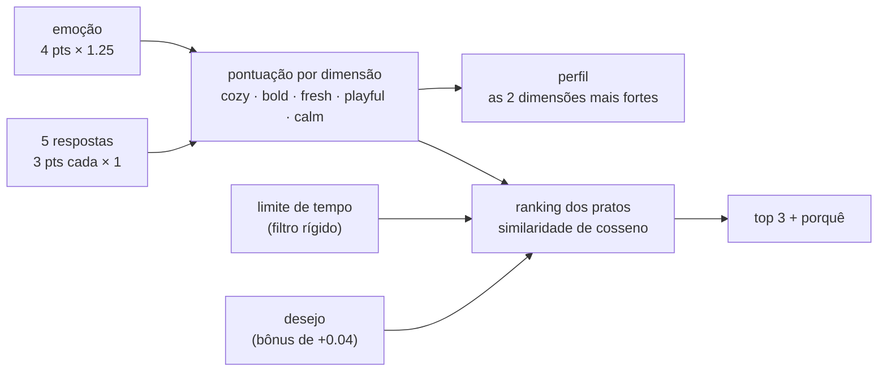

# mood-engine

Um motor de recomendação minúsculo que escolhe **o que cozinhar hoje com base em como você está se sentindo**, mais uma **auditoria** que roda todas as combinações possíveis de respostas pra conferir se a pontuação é justa de verdade.

O motor tem umas 130 linhas de TypeScript e nenhuma dependência em runtime. A parte interessante é a auditoria.

```bash
pnpm install
pnpm test           # 32 testes: pontuação, perfis, filtros e os detectores da auditoria
pnpm audit:engine   # simula todas as 3.840 combinações -> audit/reports/default.md
pnpm dev            # a demo, em http://localhost:5173
```

Precisa de Node 20+ e pnpm.

## a ideia

Quando a pessoa sabe o que quer, ela usa filtros. Quando não sabe, filtro não ajuda: "vegetariano, menos de 45 minutos" ainda te deixa encarando 40 opções.

Gente indecisa escolhe pelo humor. Então, em vez de filtros, o quiz pergunta como você está e faz umas perguntas de lado (o tempo lá fora, quem vai comer, o que você acha de lavar louça), transforma isso num perfil de gosto e te dá três pratos, cada um com um motivo curto. Limite de tempo e desejo também existem, mas vêm por último e são opcionais.

A demo e o catálogo estão em inglês; o código é comentado em português.

## como a pontuação funciona



1. **Pontos.** São cinco dimensões: `cozy` (aconchego), `bold` (intenso), `fresh` (fresco), `playful` (mão na massa) e `calm` (sossego). Toda emoção distribui 4 pontos entre elas e toda resposta distribui 3. Dentro de uma pergunta, nenhuma opção grita mais que outra (a auditoria confere).
2. **Pesos.** Cada fonte de pontos tem um multiplicador. A emoção ganha 1.25 porque é a porta de entrada do quiz; cada pergunta ganha 1. Tudo isso fica em [`src/weights.ts`](src/weights.ts), com comentários explicando cada número.
3. **Perfil.** Suas duas dimensões mais fortes dão nome ao seu perfil: `cozy + calm` é "the slow simmer", `bold + fresh` é "citrus fire", e por aí vai (10 pares, 10 perfis). Com pontos inteiros pequenos, empate acontece muito, então ele é desfeito de propósito: primeiro pelo que a emoção apontou, depois pela ordem das dimensões.
4. **Ranking.** Todo prato tem uma afinidade de 0 a 1 com cada dimensão. Os pratos são ordenados pela [similaridade de cosseno](https://pt.wikipedia.org/wiki/Similaridade_por_cosseno) entre a sua pontuação e as afinidades deles. Escolhi cosseno em vez de produto escalar puro de propósito: o produto escalar premia pratos que são "um pouco de tudo", seja quem for que pergunte. O cosseno só olha o formato do match.
5. **Filtro e preferência.** O limite de tempo é um filtro rígido: uma sopa de 2 horas não aparece quando você tem 20 minutos. O desejo é suave: soma 0.04 aos pratos que batem, o que sobe eles uma ou duas posições, mas não passa por cima do seu humor.
6. **Porquê.** Pra cada prato, o motor diz quais dimensões você e o prato têm em comum: `calm — you 59% · it 90%`.

Tudo é função pura sobre dados simples: [`scoreAnswers`](src/engine.ts), [`pickProfile`](src/engine.ts), [`rankItems`](src/engine.ts) e [`recommend`](src/engine.ts), que junta as três.

## o catálogo

Tudo inventado, tudo em [`src/data/`](src/data): 5 emoções ("drained. send help (carbs)", "fed up with everything"...), 5 perguntas, 10 perfis, 20 receitas. São objetos TypeScript simples, então dá pra ler como um arquivo de configuração, e o compilador pega dimensão escrita errada.

## por que a auditoria existe

Escrevi esse motor com ajuda de IA. Ele saiu rápido e a demo parecia certa depois de alguns cliques.

O problema é exatamente esse. "Parece funcionar" quer dizer "funcionou nas cinco combinações que eu testei". Esse quiz tem 3.840 combinações. Um sistema de pontuação pode parecer ok em todas que você testa na mão e mesmo assim:

- deixar uma pergunta decidir tudo enquanto as outras são decoração,
- ter pratos que nunca chegam em primeiro, não importa o que você responda,
- mandar metade das pessoas pro mesmo perfil,
- embaralhar o top 3 inteiro quando você muda uma resposta, ou nunca mudar nada.

Nada disso aparece numa demo. Tudo isso aparece quando você roda todas as combinações e conta. A auditoria faz exatamente isso, e faz parte do processo: construir, auditar, ajustar, auditar de novo.

## o que a auditoria checa

`pnpm audit:engine` passa todas as combinações de emoção × respostas pelo motor de verdade (uns 170ms) e grava um relatório em Markdown. O exemplo commitado é [`audit/reports/default.md`](audit/reports/default.md). O relatório é gerado em inglês; os nomes das checagens abaixo são os mesmos que aparecem nele.

| checagem | pergunta que responde | sinaliza quando |
| --- | --- | --- |
| **influence** | uma resposta decide tudo? | uma fonte sozinha explica > 30% do prato #1 ou do perfil, ou uma pergunta explica < 2% |
| **lock-in** | escolher uma resposta escolhe o prato? | uma resposta faz o mesmo prato ser #1 em > 50% das combinações dela |
| **coverage** | todo prato tem uma chance? | um prato nunca chega em #1, nunca aparece, ou é #1 mais de 3× a sua fatia justa |
| **profiles** | alguma personalidade é impossível ou está em todo lugar? | um perfil é inalcançável ou passa de 2.5× a fatia uniforme |
| **stability** | o que acontece se você muda uma resposta? | > 15% das trocas substituem o top 3 inteiro (instável) ou > 80% não mudam nada (grudado) |
| **data** | os próprios dados estão equilibrados? | uma opção distribui mais pontos que as irmãs; um limite de tempo deixa < 3 pratos |

"Explica" é a [informação mútua](https://pt.wikipedia.org/wiki/Informa%C3%A7%C3%A3o_m%C3%BAtua) como fatia da entropia do resultado: o quanto saber aquela resposta te diz sobre o resultado. 0% quer dizer nada; 100% quer dizer que dá pra adivinhar o prato só por aquela resposta.

Os limites ficam em [`audit/detectors.ts`](audit/detectors.ts). São escolhas de julgamento pra um quiz desse tamanho, escritas pra poderem ser questionadas. Use `--strict` pra fazer o script sair com código 1 quando algo for sinalizado, se quiser isso no CI.

Os detectores são testados em simulações falsas pequenas ([`test/detectors.test.ts`](test/detectors.test.ts)), e tem um teste que roda a auditoria completa nos pesos usados e falha se qualquer coisa for sinalizada. Mudou um peso e quebrou o equilíbrio? `pnpm test` avisa.

## antes / depois

[`audit/weights/unbalanced.ts`](audit/weights/unbalanced.ts) é um conjunto de pesos ruim de propósito: a emoção multiplicada por 3 e a primeira pergunta por 2, porque "parecia importante". Clicando na demo com ele, parece tudo bem. Todo resultado parece plausível.

`pnpm audit:unbalanced` discorda ([relatório completo](audit/reports/unbalanced.md)):

| | antes (`emotion × 3`, `weather × 2`) | depois (`emotion × 1.25`, todas as perguntas × 1) |
| --- | --- | --- |
| a emoção explica o prato #1 | **41,0%** ⚠️ | 19,5% |
| a emoção explica o perfil | **50,9%** ⚠️ | 22,0% |
| `company` / `dishes` / `appetite` explicam o prato #1 | **1,5% / 1,5% / 1,4%** ⚠️ | 4,1% / 5,9% / 4,1% |
| `buzzing` → summer rolls como #1 | **51,6%** ⚠️ | 23,8% |
| uma troca substitui o top 3 inteiro | **16,8%** ⚠️ | 12,5% |
| sinalizações | **6** | **0** |

Em português claro: com os pesos ruins, a primeira tela escolhe o seu jantar e três das cinco perguntas são decoração. Você responde, elas aparecem na barra de progresso, e quase não mudam nada.

Duas notas honestas de quando construí isso:

- **Minha primeira checagem de influência deixou passar.** Ela media com que frequência mudar uma resposta trocava o prato #1. Com os pesos ruins, mudar `company` ainda trocava o #1 em 35% das vezes, o que parece importar. Só que ele só alternava entre os poucos pratos que a emoção já tinha escolhido. A informação mútua pegou o que a taxa de troca não pegou. A taxa continua no relatório porque é fácil de ler, mas não é ela que dispara o alerta.
- **A auditoria não pega tudo.** Dobrar `weather` faz dela de longe a pergunta mais barulhenta (14,9% contra ~1,5% das outras), mas isso fica abaixo da linha, então só os efeitos colaterais são sinalizados. Limite é ferramenta, não veredito. Leia as tabelas, não só o resumo.

## estrutura do projeto

```
src/
  engine.ts        pontuação, perfil, ranking, "porquê" (funções puras)
  weights.ts       todo número que muda o resultado, com os motivos
  types.ts
  data/            o catálogo fictício: dimensões, emoções, perguntas, perfis, receitas
audit/
  simulate.ts      roda todas as combinações pelo motor
  detectors.ts     as checagens + os limites
  report.ts        gera o relatório em Markdown
  run.ts           CLI (pnpm audit:engine)
  weights/         o conjunto de pesos ruim de propósito
  reports/         relatórios de exemplo commitados
test/              Vitest: motor + detectores + "os pesos usados passam na auditoria"
demo/              Vite + TypeScript puro, sem framework
```

## nota de clean-room

Este é um projeto pessoal, escrito do zero. Ele parte de uma técnica que usei num trabalho para cliente (pontuar um quiz baseado em humor e auditá-lo com simulações), mas nenhum código, dado, pergunta, peso ou conteúdo daquele projeto está aqui. O domínio, o catálogo, as dimensões e os números foram todos inventados para este repositório.

## licença

MIT
