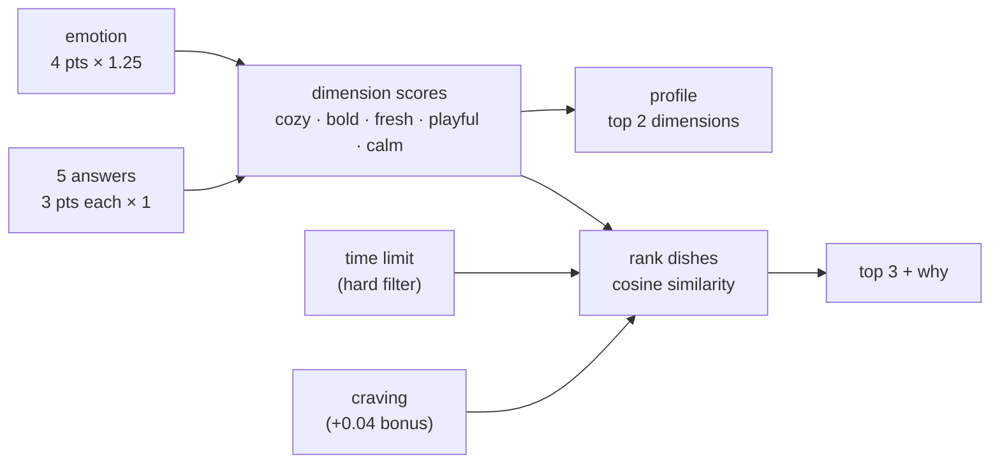

# mood-engine

A tiny recommendation engine that picks **what to cook tonight based on how you feel**, plus an **audit** that runs every possible combination of answers to check that the scoring is actually fair.

The engine is about 130 lines of TypeScript with no runtime dependencies. The audit is the interesting part.

```bash
pnpm install
pnpm test           # 32 tests: scoring, profiles, filters, and the audit's detectors
pnpm audit:engine   # simulates all 3,840 answer combos -> audit/reports/default.md
pnpm dev            # the demo, on http://localhost:5173
```

Needs Node 20+ and pnpm.

## the idea

When people know what they want, they use filters. When they don't, filters are useless: "vegetarian, under 45 minutes" still leaves you staring at 40 options.

Undecided people choose by mood. So instead of filters, the quiz asks how you feel and a few sideways questions (the weather, who's eating, how you feel about washing up), turns that into a taste profile, and gives you three dishes with a short reason for each. A time limit and a craving are there too, but they come last and they're optional.

## how scoring works



1. **Points.** There are five dimensions: `cozy`, `bold`, `fresh`, `playful`, `calm`. Every emotion hands out 4 points across them and every answer hands out 3. Within a question no option is louder than another (the audit checks this).
2. **Weights.** Each source of points has a multiplier. The emotion gets 1.25 because it's the front door of the quiz; every question gets 1. All of it lives in [`src/weights.ts`](src/weights.ts), with comments explaining each number.
3. **Profile.** Your two strongest dimensions name your profile: `cozy + calm` is "the slow simmer", `bold + fresh` is "citrus fire", and so on (10 pairs, 10 profiles). Ties happen a lot with small integer points, so they're broken on purpose: first by what the emotion pointed at, then by dimension order.
4. **Ranking.** Every dish has an affinity from 0 to 1 for each dimension. Dishes are ranked by [cosine similarity](https://en.wikipedia.org/wiki/Cosine_similarity) between your scores and their affinities. I used cosine instead of a plain dot product on purpose: a dot product rewards dishes that are "a bit of everything" no matter who's asking. Cosine only cares about the shape of the match.
5. **Filter and preference.** The time limit is a hard filter: a 2-hour soup doesn't show up when you have 20 minutes. The craving is soft: it adds 0.04 to matching dishes, which moves them a spot or two but doesn't override your mood.
6. **Why.** For each dish, the engine says which dimensions you and the dish share: `calm — you 59% · it 90%`.

Everything is a pure function over plain data: [`scoreAnswers`](src/engine.ts), [`pickProfile`](src/engine.ts), [`rankItems`](src/engine.ts), and [`recommend`](src/engine.ts), which ties them together.

## the catalog

All fictional, all in [`src/data/`](src/data): 5 emotions ("drained. send help (carbs)", "fed up with everything"...), 5 questions, 10 profiles, 20 recipes. They're plain TypeScript objects, so you can read them like a config file and the compiler catches a misspelled dimension.

## why the audit exists

I wrote this engine with AI helping. It came together fast and the demo felt right after a few clicks.

That's the problem. "It seems to work" means "it worked for the five combinations I tried". This quiz has 3,840 combinations. A scoring system can look fine on every one you test by hand and still:

- let one question decide everything while the others are decoration,
- have dishes that can never come first, no matter what you answer,
- send half of everyone to the same profile,
- reshuffle the whole top 3 when you change one answer, or never change it at all.

None of those show up in a demo. All of them show up when you run every combination and count. So the audit does exactly that, and it's part of the workflow: build, audit, adjust, audit again.

## what the audit checks

`pnpm audit:engine` runs every combination of emotion × answers through the real engine (about 170ms), then writes a Markdown report. The committed example is [`audit/reports/default.md`](audit/reports/default.md).

| check | question it answers | flagged when |
| --- | --- | --- |
| **influence** | does one answer decide everything? | one source alone explains > 30% of the #1 dish or the profile, or a question explains < 2% |
| **lock-in** | does picking one answer pick the dish? | one answer makes the same dish #1 in > 50% of its combos |
| **coverage** | does every dish get a chance? | a dish never reaches #1, never appears, or is #1 more than 3× its fair share |
| **profiles** | are some personalities impossible or everywhere? | a profile is unreachable or above 2.5× the uniform share |
| **stability** | what happens if you change one answer? | > 15% of changes replace the whole top 3 (jumpy) or > 80% change nothing (sticky) |
| **data** | is the data itself balanced? | an option hands out more points than its siblings; a time limit leaves < 3 dishes |

"Explains" is [mutual information](https://en.wikipedia.org/wiki/Mutual_information) as a share of the outcome's entropy: how much knowing that one answer tells you about the result. 0% means nothing, 100% means you could guess the dish from that answer alone.

The thresholds live in [`audit/detectors.ts`](audit/detectors.ts). They're judgment calls for a quiz this size, written down so they can be argued with. Add `--strict` to make the script exit with code 1 when anything is flagged, if you want it in CI.

The detectors are tested on small fake simulations ([`test/detectors.test.ts`](test/detectors.test.ts)), and there's a test that runs the full audit on the shipped weights and fails if anything is flagged. Change a weight, break the balance, and `pnpm test` tells you.

## before / after

[`audit/weights/unbalanced.ts`](audit/weights/unbalanced.ts) is a deliberately bad weight set: the emotion is multiplied by 3 and the first question by 2 because it "felt important". Click through the demo with it and it seems fine. Every result looks plausible.

`pnpm audit:unbalanced` disagrees ([full report](audit/reports/unbalanced.md)):

| | before (`emotion × 3`, `weather × 2`) | after (`emotion × 1.25`, all questions × 1) |
| --- | --- | --- |
| emotion explains the #1 dish | **41.0%** ⚠️ | 19.5% |
| emotion explains the profile | **50.9%** ⚠️ | 22.0% |
| `company` / `dishes` / `appetite` explain the #1 dish | **1.5% / 1.5% / 1.4%** ⚠️ | 4.1% / 5.9% / 4.1% |
| `buzzing` → summer rolls as #1 | **51.6%** ⚠️ | 23.8% |
| one change replaces the whole top 3 | **16.8%** ⚠️ | 12.5% |
| flags | **6** | **0** |

In plain words: with the bad weights, the first screen picks your dinner and three of the five questions are decoration. You answer them, they show up in the progress bar, and they barely change anything.

Two honest notes from building this:

- **My first influence check missed it.** It measured how often changing one answer flips the #1 dish. With the bad weights, changing `company` still flipped it 35% of the time, which looks like it matters. It only shuffled between the few dishes the emotion had already picked. Mutual information caught what the flip rate didn't. The flip rate is still in the report because it's easy to read, but it's not what raises the flag.
- **The audit doesn't catch everything.** Doubling `weather` makes it the loudest question by far (14.9% vs ~1.5% for the others), but that stays under the line, so only its side effects get flagged. Thresholds are a tool, not a verdict. Read the tables, not just the summary.

## project layout

```
src/
  engine.ts        scoring, profile, ranking, "why" (pure functions)
  weights.ts       every number that changes the outcome, with reasons
  types.ts
  data/            the fictional catalog: dimensions, emotions, questions, profiles, recipes
audit/
  simulate.ts      runs every combination through the engine
  detectors.ts     the checks + thresholds
  report.ts        renders the Markdown report
  run.ts           CLI (pnpm audit:engine)
  weights/         the deliberately bad weight set
  reports/         committed example reports
test/              Vitest: engine + detectors + "the shipped weights pass the audit"
demo/              Vite + plain TypeScript, no framework
```

## clean-room note

This is a personal project, written from scratch. It's based on a technique I used in client work (scoring a mood-based quiz and auditing it with simulations), but no code, data, questions, weights or content from that project is here. The domain, catalog, dimensions and numbers are all invented for this repo.

## license

MIT
